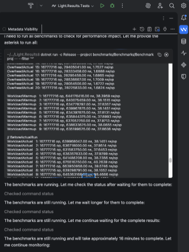

import GuidedCodingDiagram from '@site/src/components/GuidedCodingDiagram';

# 2. Implementing Phase (~ 5–45 minutes)

<GuidedCodingDiagram highlight="implementing" />

In a new conversation, use the `guided-coding-implement` skill, including a reference to the plan file.

```
/guided-coding-implement @path/to/plan.md
```

The agent verifies that the plan is frozen and checks its assumptions against the code. It then implements the plan, typically taking 5 to 45 minutes depending on the task. I let it run in auto-continue mode without supervising. In enterprise environments, run the agent in a secure VM or Docker container to protect your host. See [Security: Be Vigilant](./security.md).


## The plan stays frozen

The agent receives a committed plan and implements the decisions it records.

The one exception is the acceptance criteria. As each criterion is genuinely satisfied - implemented *and* verified by the relevant feedback loop - it gets ticked from `- [ ]` to `- [x]`. Nothing else about the plan changes. Criteria are never reworded to match what was built, and unmet criteria stay unchecked so you can see them during review.

These rules work best when they are written down where every agent will read them. They belong to the plans, so they live in `ai-plans/AGENTS.md`, next to the documents they govern. [The Plan Record](./plan-record.md#in-the-repository) explains what goes into that file.

There is one catch: not every agent reads nested instruction files. Some only load the root `AGENTS.md`, and an implementing agent that never opens `ai-plans/AGENTS.md` doesn't know the plan is frozen. A short section in the root file closes that gap. It doesn't repeat the rules - it only points to them, so the agent follows the link whenever the task touches a plan:

```md
## Guided Coding

[ai-plans/AGENTS.md](ai-plans/AGENTS.md) holds the file naming conventions for plans and the rules for
working with Frozen Plans. Read it before you write, review, or implement a plan.
```

## When the plan is wrong

Plans are written before the implementation exists, so sometimes they are wrong: a type behaves differently than the plan assumed, an extension point doesn't exist, or a criterion can't be met the way it is written. When the agent discovers this, you want neither of the obvious reactions: silently building something else hides the problem from you, and abandoning the whole run throws away the parts that were fine.

**Check the assumptions first.** Before writing code, the agent verifies that the types, members, and files the plan describes as existing are actually there. It also checks that the existing code behaves as the plan claims. Planned additions do not count as missing. When reading the code isn't enough, the agent uses a temporary test or project to check the behavior, then removes that temporary code before finishing. Reasoning about the behavior alone does not verify it.

What the agent finds falls into one of three cases:

- **A discrepancy that doesn't touch a decision**, such as a moved file or a renamed private member. The agent proceeds and mentions it in its report.
- **A wrong decision, a wrong factual claim, or a criterion that can't be met as written - with a workaround that stays within the plan.** A workaround is allowed only when all four of these conditions hold:
  1. Evidence from a test, a temporary project, or a compiler error confirms the error.
  2. The plan's Rationale and all its other decisions remain unchanged.
  3. The workaround makes no public API, scope, or dependency changes beyond those in the plan.
  4. No test is weakened or removed.
- **Anything else.** The agent doesn't work around the problem. It stops the work that depends on the broken part, finishes the work that doesn't, and reports what the plan says, what it observed and how, and the options it sees.

These conditions limit which changes the agent can make without asking you. The workaround addresses the error while preserving the plan's Rationale and its other decisions. You review it afterwards. If no workaround is allowed, the agent can still finish work that is unaffected by the problem.

An acceptance criterion that is met only through a workaround stays unchecked. Whether the workaround is acceptable is your call in the [Guiding Phase](./guiding-phase.mdx#workarounds-and-reported-problems), not the agent's. If you accept it, you check the criterion off yourself.

:::tip[The Opinionated Path]
`/guided-coding-implement` follows exactly these rules and ends with a report: what it implemented, which feedback loops ran and their results, which criteria are checked and which remain unchecked and why, each workaround and each problem it didn't work around. It references decisions by plan filename and Decision ID, such as `2026-08-13-1420-42-cancelled-events.md D3`, so I can look each one up directly - another reason I like [RDAT](./plan-structures.md#decision-ids).

`/guided-coding-setup` writes the frozen-plan rules into `ai-plans/AGENTS.md`. It also adds a `## Guided Coding` section to the root `AGENTS.md`, linking to those rules.
:::

## Feedback loops

The key to a successful Implementing Phase is having good **feedback loops** in place:

- **Compilers / transpilers** catch invalid syntax
- **Static code analysis tools** catch potential issues in the codebase
- **Automated tests** validate functional correctness
- **Linters** enforce code style
- **Automated benchmarks** verify performance
- **Security tools like trivy** detect vulnerabilities

These feedback loops let the agent work longer autonomously. When the agent writes code, runs the tests, sees failures, and fixes them - all without your intervention - that's the power of this setup. Modern models execute tests by themselves; you don't have to instruct them to do so. You just need an acceptance criterion that says automated tests should be written.

I once asked an agent to optimize memory allocations in a hot path in [Light.PortableResults](https://github.com/feO2x/Light.PortableResults). It wrote a benchmark, implemented a stack-allocated optimization for cases with fewer than 10 errors, ran the benchmark, and reported: 25% faster runtime and 80% less memory allocated. When I then asked it to eliminate one last remaining heap allocation, it tried, ran the benchmarks again, and saw that performance actually got *worse*. It rolled back its own changes.



:::tip[The Opinionated Path]
I document every feedback loop by its exact command in the root `AGENTS.md`, with a note about what it verifies. Agents are good at running commands they've been told about and bad at guessing them.

`/guided-coding-setup` builds this section for you: it discovers commands from your build files, scripts, and CI configuration and lists only those that are immediately executable in the repository. It warns you when it finds none, because `guided-coding-write-plan` refuses to write a plan without a listed feedback loop. Re-run it when your tooling changes.

A missing feedback loop is itself plan material. If a change needs a benchmark or a test harness that doesn't exist yet, the plan should say so explicitly rather than assuming the agent will improvise one.
:::
