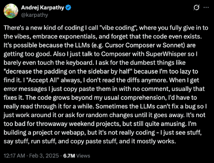

import GuidedCodingDiagram from '@site/src/components/GuidedCodingDiagram';

# Guided Coding & Guided Learning

## TL;DR

Guided Coding is a way to develop software with AI coding agents in three phases: **Plan**, **Implement**, and **Guide**. You discuss the approach with the agent, let it implement the plan, and review the resulting code yourself. You remain responsible for understanding and accepting every change.

<GuidedCodingDiagram />

- **Plan** with the agent, revising the approach together. Before you finish, ask "Would you change anything about the plan?" Repeat until the plan is stable, then freeze it and commit it to git. A **frozen** plan records what you decided at that point. From then on, the only permitted edit is checking off verified acceptance criteria.
- **Implement** by giving the agent one focused plan in a fresh conversation. Automated feedback loops, such as tests, linters, and benchmarks, help it verify its work.
- **Guide** by reviewing all generated code. This is where you spend most of your time. **Understand the code** and check that it meets the plan. Request small fixes with a targeted prompt. For larger changes, write a follow-up plan with the agent. Write a **Plan Deviations** document whenever follow-up plans exist or the finished code materially changes or rejects an explicit decision in the accepted plans.

You guide the work throughout all three phases: directly in the Planning and Guiding Phases, and through the plan and feedback loops in the Implementing Phase.

Keep [rules files](./rules-files.md) limited to information agents cannot reliably discover from the code or should not have to rediscover, such as team workflow rules, feedback-loop commands, and rules against repeated mistakes. Adjust [plan size](./finding-the-right-plan-size.md) based on your experience with the models you use. Review the result for correctness, performance, and security.

**Guided Learning** is a variant for developers who are still learning the domain a plan touches: in the Implementing Phase, you write the code yourself while the agent teaches you, ideally with a senior developer at your side during Planning and Guiding. See [Guided Learning: Getting Started](./guided-learning-getting-started.mdx).

## A Methodology, Not a Framework

You can practice Guided Coding with Markdown files, git, and the coding agent you already use. No additional tools are required.

These docs explain the method alongside the plan structure, filenames, commit timing, and [Agent Skills](https://github.com/feO2x/guided-coding) I use every day. You can adopt this setup or adapt it to your own workflow. The two layers are:

- **The method** - the regular text explains the approach and why it works, regardless of your language, issue tracker, or agent.
- **The Opinionated Path** - callouts show **how I work**, including the prompts, filenames, and skills I use. These details are optional.

:::tip[The Opinionated Path]
Callouts like this one show my setup. The [Guided Coding skills](https://github.com/feO2x/guided-coding) automate it, and [Guided Coding: Getting Started](./guided-coding-getting-started.mdx) walks through it from installation to pull request.
:::

The skills write drafts, run plan reviews, freeze plans, and record deviations. You still need to discuss the approach, understand the plan, and review every changed line of code.

## Why Not Vibe Coding?

Andrej Karpathy, co-founder of OpenAI, [coined the term Vibe Coding in February 2025](https://x.com/karpathy/status/1886192184808149383). The core idea: you tell the coding agent what to do, never go down to the source code level, always click "accept all changes", and the code grows beyond usual comprehension. You only validate by looking at the running app - never at the code itself.

Vibe Coding can be fun for personal projects and useful for rapid prototyping. For production software, you need to understand how the code works and be able to maintain it. I developed Guided Coding to work faster with agents while keeping that understanding and control.

## Where to Go Next

- Want to try the tooling right away? Start with [Guided Coding: Getting Started](./guided-coding-getting-started.mdx).
- Want to understand the method? Read the [Planning](./planning-phase.mdx), [Implementing](./implementing-phase.mdx), and [Guiding](./guiding-phase.mdx) phases in order.
- Want to know how the plans stack up over time? Read [The Plan Record](./plan-record.md).
- Want to write the code yourself and learn along the way? Read [Guided Learning: Getting Started](./guided-learning-getting-started.mdx).
- Want to know what changed in the latest version of the skills? Read the [Release Notes](./release-notes.md).
